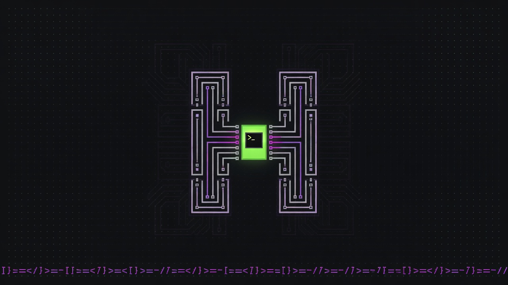
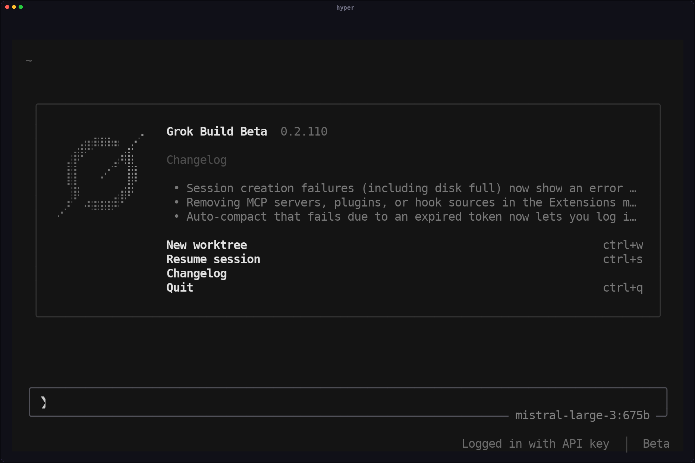

<div align="center">

<h1>gr0k (<code>gr0k</code>)</h1>



<p>
  <a href="https://github.com/opensamai/gr0k/releases"></a>
  <a href="https://github.com/opensamai/gr0k/actions/workflows/release.yml"></a>
  <a href="LICENSE"></a>
  
  
  <a href="https://github.com/opensamai/gr0k/releases"></a>
  
</p>

**gr0k** is an unofficial multi-provider community build of
[Grok Build](https://github.com/xai-org/grok-build) — a terminal-based AI
coding agent written in Rust, with first-class multi-provider LLM support:
xAI Grok, Kimi Code / Moonshot, ChatGPT Codex, OpenAI, Anthropic, Z.AI,
Ollama Cloud, and more.

It runs as a full-screen TUI that understands your codebase, edits files,
executes shell commands, searches the web, and manages long-running tasks —
interactively, headlessly for scripting/CI, or embedded in editors via the
Agent Client Protocol (ACP). The UI is localized in 10 languages
(English, 简体中文, 繁體中文, 日本語, 한국어, Español, Português, Français,
Deutsch, Русский) and switchable live from Settings. A local, read-only Rust web
dashboard is available with `gr0k dashboard --web` for session metrics,
timelines, charts, logs, and live event streaming.

[Installation](#installation) ·
[Providers](#providers) ·
[Building from source](#building-from-source) ·
[Releasing](#releasing) ·
[Coexistence with official <code>grok</code>](#coexistence-with-official-grok) ·
[License](#license)

**中文文档: [README.zh-CN.md](README.zh-CN.md)** ·
**中文用户指南: [docs/user-guide-zh-CN/](crates/codegen/xai-grok-pager/docs/user-guide-zh-CN/)**

</div>

---

## Screenshots

The real TUI (captured in a PTY with the in-repo
[`tui_shot`](crates/codegen/xai-grok-pager-pty-harness/examples/tui_shot.rs)
harness), in two of the ten UI locales:

| English | 简体中文 |
| ------- | -------- |
|  |  |

---

## Why “gr0k”?

This community build used to ship as `hyper`. The product is now **gr0k**,
and the repository is [opensamai/gr0k](https://github.com/opensamai/gr0k).
Current source, including the official Grok Build merge plus the
multi-provider patches, is the `merge-official` branch. `main` is still the
older single-platform snapshot.

| | Official | This build |
|---|---|---|
| Product | Grok Build | **gr0k** |
| Binary | `grok` | **`gr0k`** |
| Install root | `~/.grok` | **`~/.gr0k`** (binary only) |
| Config / auth / sessions | `~/.grok` | **`~/.grok`** (shared runtime) |
| Upstream | [xai-org/grok-build](https://github.com/xai-org/grok-build) | `merge-official` |

`GR0K_SHARE_DIR` overrides the install root. The old `HYPER_SHARE_DIR` name
still works. A previous `~/.hyper/bin/hyper` install is left in place; new
installs use `~/.gr0k/bin/gr0k`.

---

## Installation

The installer downloads a release archive, checks it against `SHA256SUMS`,
and links `~/.gr0k/bin/gr0k` (`%USERPROFILE%\.gr0k\bin\gr0k.exe` on Windows).

```sh
# macOS / Linux — script from the merged branch
curl -fsSL https://raw.githubusercontent.com/opensamai/gr0k/merge-official/install.sh | bash
```

```powershell
# Windows PowerShell
irm https://raw.githubusercontent.com/opensamai/gr0k/merge-official/install.ps1 | iex
```

```sh
gr0k --version
gr0k                # start the TUI
```

The release currently published as `v0.2.115` is the older snapshot: one
macOS arm64 archive still named `hyper-0.2.115-…`. The merged tree keeps the
same version number but ships the binary as `gr0k` for five targets
(macOS arm64/x86_64, Linux glibc arm64/x86_64, Windows x86_64). Those
archives are produced by
[`.github/workflows/release.yml`](.github/workflows/release.yml) and are
**not** attached to a Release until a new tag is pushed. Until then, install
this tree from source (below). A manual workflow run uploads artifacts only
and does not publish a Release.

> macOS Gatekeeper still warns on a downloaded unsigned binary. `install.sh`
> clears the quarantine flag after install. Signing and notarization need an
> Apple Developer ID and are not part of CI.

---

## Providers

gr0k keeps the multi-provider registry from this tree (see the pager
[user guide](crates/codegen/xai-grok-pager/docs/user-guide/)):

| Platform | Auth | Notes |
| -------- | ---- | ----- |
| xAI / Grok | `gr0k login` (OIDC) or `XAI_API_KEY` | First-party models |
| Kimi Code | `gr0k login --kimi` or `/kimi` | Device OAuth; `kimi-code/*` |
| Moonshot CN / AI | API key | open platform |
| ChatGPT Codex | `gr0k login --openai` or `/codex` | ChatGPT OAuth; experimental `/live` voice |
| **Anthropic Claude (Pro/Max)** | **`gr0k login --claude`** or **`/claude`** | Subscription login; `anthropic-claude/*` |
| **Nexus relay gateway** | **`/nexus <key> [base_url]`** (TUI) or `NEXUS_API_KEY` | Self-hosted OpenAI/Anthropic-compatible relay; `nexus/*` |
| OpenAI / Anthropic / DeepSeek-style | API keys | BYOK catalog |
| Z.AI Coding Plan | platform key | international plan |
| Ollama Cloud | API key | live roster sync |

Model ids in the picker look like `{platform}/{model}` (e.g.
`kimi-code/k3`, `codex:gpt-5.5`). Platform docs live under
`crates/codegen/xai-grok-pager/docs/user-guide/` (Moonshot, Kimi Code,
OpenAI Codex, …).

Config and credentials still live under **`~/.grok`** (same paths as
upstream Grok Build), so existing sessions, API keys, and `auth.json`
keep working.

A 401 on Kimi, Codex, or Claude refreshes **that** subscription. It does not
fall through to the xAI session. Open-platform BYOK endpoints (Ollama and
similar) are not “fixed” by refreshing xAI either. `gr0k logout --all` clears
the xAI session and the Kimi, Codex, and Claude OAuth scopes. It does not
delete BYOK platform keys.

```sh
gr0k login                  # xAI / Grok
gr0k login --kimi           # Kimi Code
gr0k login --openai         # ChatGPT Codex (alias: --chatgpt)
gr0k login --claude         # Claude Pro/Max (alias: --anthropic)
gr0k logout --kimi          # one scope
gr0k logout --openai
gr0k logout --claude
gr0k logout --all           # xAI + the three subscription scopes
```

### Themes

`/theme` includes the upstream themes plus the gr0k preset set: Everforest,
Nord, Dracula, Gruvbox, Catppuccin Mocha/Latte, Solarized dark/light,
Deep Ocean, Ember, Midnight OLED, and Paper. `terminal` leaves the terminal
background untouched. `auto` follows the system appearance. Preset ids `6`
through `17` are stable on-disk values; do not renumber them.

### Anthropic Claude login (Pro/Max)

Sign in with an Anthropic Claude **Pro/Max subscription** and use
`anthropic-claude/*` models directly — no API key required. Auth is a
browser OAuth flow (PKCE + loopback callback; manual paste is supported for
headless/remote machines). It is **independent of the xAI login**, so you can
be signed into Grok and Claude at the same time.

```sh
# TUI (simplest): one command; the login persists after that
/claude                     # same as /login claude

# CLI: opens the browser OAuth flow
gr0k login --claude        # alias: gr0k login --anthropic

# Sign out again
gr0k logout --claude       # or: gr0k logout --all
```

Credentials are stored under the `oauth/anthropic-claude` scope in
`~/.grok/auth.json`; the token is refreshed automatically. After logging in,
pick any `anthropic-claude/*` entry from the model picker.

### Nexus relay gateway (中转站)

**Nexus** is a self-hosted, OpenAI/Anthropic-compatible **relay gateway**
(BYOK, Bearer API key). One key unlocks all three backends it proxies —
OpenAI `chat/completions`, Claude **Messages**, and the **Responses** API —
and the model list is discovered live from the gateway's `/models`.

The gateway root defaults to `https://nexuscore.now`. Because Nexus is
self-hosted, you can point it at your own deployment three ways:

```sh
# 0. CLI (works BEFORE any xAI login) — global one-time setup
gr0k nexus <api_key>                   # save the key to ~/.grok/auth.json
gr0k nexus <api_key> https://your-gw   # save key + custom gateway root
gr0k nexus --clear                     # remove the stored key
gr0k nexus                             # print setup guide + current status

# 1. TUI (simplest) — enter the key once; it persists to ~/.grok/auth.json
/nexus                                 # print setup guidance (how to get a key)
/nexus <api_key>                       # use the default root
/nexus <api_key> https://your-gateway  # persist a custom gateway root
/nexus clear                           # remove the stored key (alias: off / logout)
#    (all equivalent to /providers nexus …, just shorter)

# 2. Environment variables
export NEXUS_API_KEY=sk-nexus-…       # or GROK_NEXUS_API_KEY
export GROK_NEXUS_BASE_URL=https://your-gateway   # override the root

# 3. Either way, models then appear as nexus/* in the picker
```

The base URL accepts any client-facing shape (`https://your-gateway`,
`…/v1`, `…/openai/v1`) — gr0k normalizes it to the bare root and derives the
per-backend paths (`{root}/openai/v1`, `{root}/v1`) automatically. The key
and root are saved to `~/.grok/auth.json` alongside the other providers.

---

## Building from source

Requirements:

- **Rust** — pinned by [`rust-toolchain.toml`](rust-toolchain.toml)
  (`rustup` installs it on first build)
- **[DotSlash](https://dotslash-cli.com)** — hermetic `bin/protoc`
  ```sh
  cargo install dotslash
  # or: brew install dotslash
  ```
- **CMake 3.5+** — builds the bundled static Opus library used by experimental
  `/live` voice (the workspace pins `CMAKE_POLICY_VERSION_MINIMUM=3.5`)

```sh
cargo run -p xai-grok-pager-bin              # build + launch TUI (binary: gr0k)
cargo build -p xai-grok-pager-bin --profile release-dist
./target/release-dist/gr0k --version
```

The composition-root package is still `xai-grok-pager-bin` (monorepo
layout); the **shipped binary name** is `gr0k`.

### Install a source build globally

To run your own edits as the managed `~/.gr0k/bin/gr0k` (the same layout
`install.sh` produces, but built from this checkout instead of a GitHub
Release), use [`scripts/install-local.sh`](scripts/install-local.sh):

```sh
scripts/install-local.sh                 # build + install over ~/.gr0k/bin/gr0k
scripts/install-local.sh --no-link       # build + stage in downloads/, keep current symlink
GR0K_SHARE_DIR=~/.gr0k-dev scripts/install-local.sh   # install to a separate root
```

It runs `cargo install --locked`, stages a versioned binary under
`~/.gr0k/downloads/`, re-signs it on macOS, smoke-tests `--version`, then
atomically repoints `~/.gr0k/bin/gr0k`. Requires `cargo`, `cmake`, and a real
`ripgrep` binary (auto-detected, or set `GROK_SHELL_BUNDLE_RG_PATH`). The first
build takes ~13 min.

---

## Changelog

See [`CHANGELOG.md`](./CHANGELOG.md) for release notes. Known limitations:
[`docs/KNOWN_ISSUES.md`](./docs/KNOWN_ISSUES.md).

---

## Releasing

1. Set the root [`VERSION`](VERSION) file to the **monorepo lockstep client
   version** (same as `crates/codegen/xai-grok-pager/Cargo.toml` /
   `xai-grok-version`, currently `0.2.115`). CI compiles this into
   `x-grok-client-version`; xAI rejects clients below **0.1.202** (HTTP 426).
   Do **not** invent a separate low marketing version (e.g. `0.1.0`).
2. Commit on `merge-official` (or your release branch); update `CHANGELOG.md`.
3. Tag and push — CI builds five targets and publishes a GitHub Release.
   `workflow_dispatch` builds the same targets and uploads Actions artifacts
   only. The Windows target currently fails to compile `cc` 1.2.48 on
   Rust 1.94 (`FILE_ATTRIBUTE_TEMPORARY` is `i32` there); macOS and Linux
   do not compile that code.

```sh
VERSION=$(tr -d '[:space:]' < VERSION)
git tag "v${VERSION}"
git push origin "v${VERSION}"
```

Workflow: [`.github/workflows/release.yml`](.github/workflows/release.yml)

Artifacts:

| Asset | Example |
| ----- | ------- |
| macOS arm64 | `gr0k-0.2.115-aarch64-apple-darwin.tar.gz` |
| macOS x86_64 | `gr0k-0.2.115-x86_64-apple-darwin.tar.gz` |
| Linux x86_64 (glibc) | `gr0k-0.2.115-x86_64-unknown-linux-gnu.tar.gz` |
| Linux arm64 (glibc) | `gr0k-0.2.115-aarch64-unknown-linux-gnu.tar.gz` |
| Windows x86_64 | `gr0k-0.2.115-x86_64-pc-windows-msvc.zip` |
| Checksums | `SHA256SUMS` |

The tag must match `VERSION` exactly (`v0.2.115` ↔ `0.2.115`) or the build fails.

---

## Coexistence with official `grok`

gr0k is **not** affiliated with xAI / SpaceXAI. On the same machine:

| Surface | Official `grok` | gr0k |
|---------|-----------------|-------|
| Binary | `grok` | `gr0k` |
| Managed install root | `~/.grok/bin` | `~/.gr0k/bin` (legacy `~/.hyper/bin`) |
| Config / auth / sessions | `~/.grok` | **same** `~/.grok` |
| Leader IPC (`leader*.sock` / `.lock`) | under `~/.grok` | **same** namespace |

Implications:

- Sessions, API keys, and OAuth scopes are shared — log in once, both CLIs can see them.
- Leader list/kill can see both products’ leaders. Prefer killing only leaders you started.
- Community builds disable the upstream self-updater so `gr0k update` cannot overwrite `~/.grok/bin/grok`. Upgrade gr0k by re-running `install.sh` / `install.ps1`.

Nothing in the official installer is rewritten by gr0k’s install script.

---

## Building notes (this fork)

```sh
# Defaults enable community-build (gr0k branding + no upstream updater).
cargo run -p xai-grok-pager-bin

# Explicit release-style local binary
cargo build -p xai-grok-pager-bin --profile release-dist --features community-build
```

Amp-style **agent modes** (low / medium / high / ultra slots) are **design-only** —
see [`docs/design-modes.md`](docs/design-modes.md). They are not shipped yet.

Known issues and remaining work: [`docs/KNOWN_ISSUES.md`](docs/KNOWN_ISSUES.md).

---

## Documentation

In-tree user guide (examples may still say `grok`; the gr0k binary name is
`gr0k`, paths remain under `~/.grok`):

- English: [`crates/codegen/xai-grok-pager/docs/user-guide/`](crates/codegen/xai-grok-pager/docs/user-guide/)
- 中文: [`crates/codegen/xai-grok-pager/docs/user-guide-zh-CN/`](crates/codegen/xai-grok-pager/docs/user-guide-zh-CN/)

Related extension docs also have Chinese translations (`*.zh-CN.md`) under
`crates/codegen/xai-grok-pager/docs/`.

Upstream product docs: [docs.x.ai/build](https://docs.x.ai/build/overview)

`SOURCE_REV` records the monorepo commit this tree was last synced from.

---

## Repository layout

| Path | Contents |
|------|----------|
| `crates/codegen/xai-grok-pager-bin` | Composition root; builds the `gr0k` binary |
| `crates/codegen/xai-grok-pager` | TUI |
| `crates/codegen/xai-grok-shell` | Agent runtime |
| `install.sh` / `install.ps1` | Release installers |
| `.github/workflows/release.yml` | Multi-target release CI |

> [!IMPORTANT]
> The root `Cargo.toml` (workspace members / dependency versions) is
> **generated** from the monorepo — treat it as read-only. Prefer editing
> per-crate `Cargo.toml` files for local changes that should survive syncs.

---

## License

Apache-2.0. See [`LICENSE`](LICENSE), [`NOTICE`](NOTICE), and
[`THIRD-PARTY-NOTICES`](THIRD-PARTY-NOTICES).

Based on Grok Build open source
([xai-org/grok-build](https://github.com/xai-org/grok-build)).
